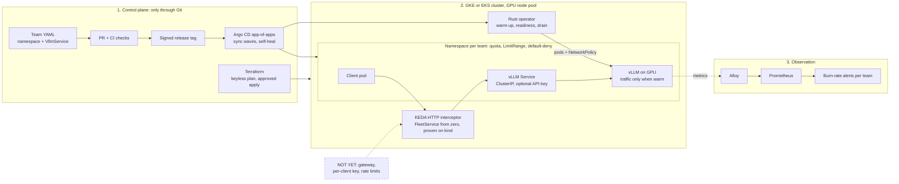

# LLM inference platform: a walkthrough for the CTO

*Designed, built and verified under simulated production load; evidence in CI. It has not served real users.*

## 0. Why this platform exists
**Serving an LLM is mostly paying for GPUs, and the decisions that set that cost are still made by hand.**

I spent eight years building cost models for manufacturers. When I moved to LLM inference I asked the same question, what does serving cost and why, and measured it on real GPUs for six months. Three answers stood out:
- **Cold start:** a replica still loading weights is paid for and cannot serve.
- **Waiting:** agents keep GPUs busy doing nothing while their tools run.
- **Preemption:** losing a spot node only costs errors if nobody plans for it.

Each is a decision a platform should take for the team, not something every team should solve on its own.

The same three decide whether a traffic peak is served or dropped: capacity that arrives late, capacity held idle, capacity lost mid-request.

**What it is built on.** Each problem has earlier measurements behind it, cited in the operator's design decisions:

| Problem | Earlier work and what it found | What the platform decided |
|---|---|---|
| Cold start | vllm-coldstart-probe (eBPF, Rust): engine construction 11.7-19.0 s eager, 47.7 s with CUDA graphs (7B, A10); cuda-graphs-experiment (H100): decode faster in every configuration, end-to-end throughput +8.5% to -5.2% | cold start is a lifecycle state, warm-up a documented trade-off; the operator is in Rust (ADR-0001, 0002, 0009) |
| Waiting | agentic-kv-energy-experiment (H100): +69% tokens per joule from KV-cache reuse | placement is an energy decision (ADR-0006, 0007) |
| Preemption | no earlier experiment: designed in the operator | only a preemption notice or a cordon moves a placement, one at a time by default; with no eligible target the fleet drains and holds; a pod leaves the Service before it stops serving (ADR-0005, 0017, 0019) |
| Price, across all three | inferscope: sampled timelines; cost-attribution rules | the concurrency bound and the cost model (ADR-0010, 0025) |

**How it is tested.** The upstream simulator llm-d-inference-sim (it counts one word as one token) is the method, not a finding: every scaling and fault path runs in CI on kind, at zero GPU cost (ADR-0009, 0012 to 0015).

**What it is:** a reference platform for serving models on GPUs inside a company. A product team declares a model, a latency objective and a budget; the platform provisions, delivers, secures, observes and prices it, on GCP or AWS. Every claim is verifiable with a command.

**Where it stops today (I say this first):**
- The model-promotion bridge is not yet wired to Argo CD.
- Cost is computed per scenario, offline, not per team. The budget is declared and exported as a metric, but not enforced.
- Team separation (tenancy) is in Git and CI, not yet proven on a live cluster.

## 1. Architecture: one change, one request
**Git is the only way in; the operator is the only thing that touches GPUs; every team gets its own alert.**

*Example:* a support team wants a 7B model that answers within 1 second for 95% of requests, for at most 500 EUR a month. It commits [one file](https://github.com/MicheleCampi/gke-llm-inference-platform/blob/main/teams/demo/qwen-7b.yaml):

    kind: VllmService
    spec:
      model: "Qwen/Qwen2.5-7B-Instruct"
      image: "vllm/vllm-openai:v0.11.0"
      replicas: 1
      gpu: 1
      warmupStrategy: Eager
      objective: { ttftSeconds: 1.0, percentile: 95 }
      budget: { eurPerMonth: 500 }

**How to read it:** three columns, left to right: who decides, what runs, who watches. Solid arrows: who creates or drives what. Dashed: metrics, or a piece that does not exist yet.

**Journey 1: how a change gets in.**
1. The team writes a namespace and a VllmService (model, objective, budget).
2. It opens a PR. CI checks it before it lands, for example that the namespace has quota, limits and default-deny.
3. Merge and a signed release tag. Argo CD follows the tag, not the latest commit.
4. Argo CD makes the cluster match Git in sync waves: projects, then platform services, then teams.
5. The operator sees the VllmService, creates the vLLM pods, Service and NetworkPolicy, warms the model and marks it Ready only when warm.

Underneath, Terraform has already built network, cluster and GPU pool: keyless plan in CI; apply from CI as a separate identity, behind a reviewer.

> Nobody runs kubectl apply. A change is a pull request: CI checks it, a signed tag releases it, Argo CD applies it, the operator turns it into running pods.

**Journey 2: how a request travels.**
1. The team's client calls KEDA's HTTP interceptor.
2. If a FleetService is at zero, the interceptor holds the request and scales it to one. The pod asks for a GPU, the pool adds a node, vLLM loads the weights: that is the cold start.
3. Once the pod is Ready, the request reaches the vLLM Service (ClusterIP, internal only; an API key from a Secret is supported, not set in the demo teams).
4. vLLM generates the answer on the GPU.
5. Metrics flow through Alloy to Prometheus, which tracks the burn rate of the team's time-to-first-token objective.

Scale from zero applies to a FleetService, the only kind with a scale subresource; a single VllmService, like the example above, runs at its declared replicas.

**If it breaks.** What the design does, and where to check it.

| Failure | What happens | Evidence |
|---|---|---|
| **Does control break?** | | |
| Someone changes the cluster by hand | Argo CD puts it back as in Git (auto-sync, prune, self-heal) | `argocd/root-app.yaml`, GKE repo |
| A reconcile hangs | It fails after 30 s and is counted in `vcso_reconcile_failures_total` | Operator CHANGELOG |
| Argo CD or the operator stops | Running pods keep serving; nothing new lands until it is back | Kubernetes behaviour; not tested live here |
| Docker Hub is down | Builds take base images from mirror.gcr.io | Operator CHANGELOG |
| **Does capacity disappear?** | | |
| A GPU node is drained or preempted | The replica leaves the Service 110 s before it stops; responses in flight finish; it moves to another node | ADR-0019; CI drain and preemption job under load, which fails if an open stream is cut, operator repo |
| Several nodes go at once | Only a preemption notice or a cordon moves a placement, one at a time by default; with no eligible target the fleet drains and holds instead of cascading | ADR-0005, 0017; kind validation, `docs/PROVENANCE.md` |
| **Does the service degrade?** | | |
| The model gets slow, or its metrics disappear | Burn-rate alerts on time to first token, a target-down alert, a runbook | ADR-0021; `docs/runbooks/ttft-burn-rate.md`, operator repo |

**Not yet:** no gateway or external endpoint, no per-client key, no rate limits, no identity per team, tenancy not applied live.

## 2. Terraform, Helm, Argo CD and Kubernetes: where and how
**Terraform builds the ground, Argo CD keeps the cluster equal to Git, Helm is how software is packaged, and Kubernetes runs it, with my operator as the only thing that touches GPUs.**

| | Start reading at | What it does | Why this way | Check |
|---|---|---|---|---|
| Terraform, GKE | gke [`terraform/main.tf`](https://github.com/MicheleCampi/gke-llm-inference-platform/blob/main/terraform/main.tf) -> [`modules/gke-gpu/main.tf`](https://github.com/MicheleCampi/gke-llm-inference-platform/blob/main/terraform/modules/gke-gpu/main.tf) | APIs, VPC, subnet; regional cluster, system pool, L4 pool 0..1, Workload Identity, Dataplane V2 | regional, any zone, flex-start: on 24/10 every L4 zone in europe-west4 and europe-west1 was out of stock, so a scale-up must not depend on one zone; the GPU pool goes to zero, so idle capacity costs nothing | `terraform validate`, trivy (an obsolete exception fails CI), plan in CI |
| Terraform, CI identity | gke [`bootstrap/ci-identity/main.tf`](https://github.com/MicheleCampi/gke-llm-inference-platform/blob/main/bootstrap/ci-identity/main.tf) | Workload Identity pool and provider for GitHub; plan and apply service accounts, one per GitHub environment | no long-lived keys; apply only from main, on the saved plan, behind a reviewer | plan and apply jobs behind approvals |
| Terraform, EKS | [eks](https://github.com/MicheleCampi/eks-llm-inference-platform), modules `vpc` and `eks` | the same platform on AWS | validated, never applied | `terraform validate` |
| Helm, written | operator [`chart/`](https://github.com/MicheleCampi/vllm-coldstart-operator/tree/main/chart) | operator, CRD and values as one versioned chart | one unit for Argo CD to install | `helm template` |
| Helm, consumed | gke [`argocd/apps/`](https://github.com/MicheleCampi/gke-llm-inference-platform/tree/main/argocd/apps) | argo-cd 9.5.21, external-secrets 2.6.0, alloy 1.10.0, each version pinned | an upgrade is a reviewed diff | version in Git |
| Argo CD | gke [`argocd/root-app.yaml`](https://github.com/MicheleCampi/gke-llm-inference-platform/blob/main/argocd/root-app.yaml) | root app at tag v0.6.0 installs `argocd/apps/` in sync waves: -2 root; -1 projects, argo-cd, external-secrets; 0 monitoring, operator; 1 alloy. Each team app (team-demo, team-b) syncs in three steps: -1, 0, 1. One AppProject per role and per team | the cluster changes only from Git, in a stated order: for each team, first what it may deliver, then its namespace, quota and deny-all, then its services; a team can ship only VllmService and FleetService, into its own namespace | sync status |
| Kubernetes, API | operator [`src/bin/crdgen.rs`](https://github.com/MicheleCampi/vllm-coldstart-operator/blob/main/src/bin/crdgen.rs) | VllmService with objective and budget; the operator owns its Deployment, Service and NetworkPolicy | the team speaks in models, not pods | gke [`ci/validate.sh`](https://github.com/MicheleCampi/gke-llm-inference-platform/blob/main/ci/validate.sh): kubeconform with CRD schemas, negative tests |
| Kubernetes, tenancy | gke [`tenants/demo/`](https://github.com/MicheleCampi/gke-llm-inference-platform/tree/main/tenants/demo), [`ci/new-team.py`](https://github.com/MicheleCampi/gke-llm-inference-platform/blob/main/ci/new-team.py) | Namespace, ResourceQuota, LimitRange and deny-all NetworkPolicy per team | onboarding is one command | [`ci/check-tenancy.py`](https://github.com/MicheleCampi/gke-llm-inference-platform/blob/main/ci/check-tenancy.py) in CI |

**Terraform.** Plan in CI with a keyless identity federated from GitHub; the plan identity can only read. State in a GCS backend, which locks natively. Apply runs from CI as a second identity, only from main, on the saved plan, after a required reviewer: wired, not yet exercised. Resources that already existed are adopted with import blocks, not recreated: External Secrets' service account, its read access to one secret, and its Workload Identity binding; the plan showed 3 to import, 0 to change, 0 to destroy (gke #23).

**Argo CD.** Bootstrapped once by hand: install the argo-cd chart, apply `root-app.yaml`; it reads the public repo over HTTPS, so there is no secret to bootstrap. That is the only manual apply. From there Argo CD manages itself with the same pinned chart, and Terraform never touches it. It follows a signed tag, not a branch, so rollback is going back one tag. Self-heal puts back manual changes; prune removes what left Git.

**Helm.** I write one chart (the operator, its CRD and values) and consume three, each pinned. A chart version is a dependency: bumped in a PR, rendered with `helm template` in CI before Argo CD sees it. Nobody runs `helm install` after bootstrap.

**Kubernetes.** The team speaks in models, not pods: VllmService is the API, and the operator owns the Deployment, Service and NetworkPolicy behind it. The concepts that matter here:
- readiness means warm, not just started (ADR-0002);
- GPU nodes are tainted so only vLLM pays for them;
- graceful shutdown takes the pod out of the Service before it stops (ADR-0019);
- every reconcile has a time limit (ADR-0016).

I checked enforcement before writing policy: GKE was not enforcing NetworkPolicy, so I turned on Dataplane V2.

**Where I am weak, and what I would do next:**
- Terraform apply from CI is wired but not yet exercised: `apply.yml` (main only) applies the saved plan after a required reviewer, as `terraform-apply-ci`, federated only for that environment; the plan identity stays read-only (gke #26). Its project-wide service-account roles are an accepted trivy finding with an expiry (GCP-0011); the fix is to scope them to the accounts Terraform creates, once the first apply proves the role set.
- A team is files generated by `new-team.py`, not an ApplicationSet over a team chart; at around 20 teams I would switch.
- No identity per team yet (RBAC on groups).
- Tenancy has never been applied on a live cluster.
- The GPU pool is capped at one node by budget, not by design: `max_gpu_nodes` (default 1) and the GPU zones are variables, and with flex-start a scale-up waits in a queue when no zone has an L4.

## 3. What works today, with evidence
**Measured against a full company platform: about 46%, 12 of 35 items done and 8 partial. The foundations are complete: every claim re-runs with a command.**

**What a team gets:**

| The team... | Today | Next |
|---|---|---|
| gets a served model from one file, validated on submit | yes | delivered by Argo CD from the model registry |
| never gets traffic on a replica that is still warming | yes (ADR-0002, 0009) | |
| keeps serving when a spot node is taken away | yes, under load in CI on kind: open streams at each fault, none cut (ADR-0005, 0019) | on GPU |
| scales to zero and wakes on demand | yes, for a FleetService, on kind (ADR-0015) | tested on GPU |
| is alerted on its own error budget | yes, for a 1 s objective (ADR-0021) | any objective |
| sees its spend against its budget | budget exported; cost per run (ADR-0025) | cost per team (showback) |
| is onboarded with one command into its own namespace: GPU quota, default-deny network, boundaries checked in CI | in Git and CI ([#19](https://github.com/MicheleCampi/gke-llm-inference-platform/pull/19), [#20](https://github.com/MicheleCampi/gke-llm-inference-platform/pull/20)); not yet run live | identity per team |

**Status by layer** (percentage = done + partial/2, over 35; foundations counted apart):

| Layer | Items | Done | Partial |
|---|---|---|---|
| Foundations: truth and verification | 22 | 22 | 0 |
| Provisioning on two clouds | 3 | 1 | 1 |
| Delivery: GitOps and models | 3 | 0 | 1 |
| Self-service contract | 8 | 3 | 2 |
| Signals | 4 | 0 | 1 |
| Security and tenancy | 2 | 1 | 0 |
| Reliability | 8 | 5 | 1 |
| Cost | 2 | 1 | 1 |
| Operations and readiness | 5 | 1 | 1 |
| **Platform layers (excluding foundations)** | **35** | **12** | **8** |

**Where it is strongest:**
1. **Every claim re-runs with a command.** When the evidence did not hold, I retracted my own numbers: a "~18 s" cold start that came from a README and no capture, and a claim that cold start was not I/O-bound.
2. **Failures are tested under load, in CI.** A reproducible load profile; SLO, error budget and per-replica capacity measured; a cordoned node and a preemption exercised under traffic (ADR-0012, 0013, 0017 to 0019). The job found a defect the objectives could not see: the replay met every objective while a drain cut 3 of 4 open streams. A preStop wait fixed it; the job now fails if any open stream is cut (ADR-0019).
3. **Scaling is measured, in CI on kind.** A fleet adds a replica when requests in flight pass 1.3 per replica, up to 3. The threshold is not a guess: one replica at its measured capacity serves 0.4 req/s for 3.36 s each, so it holds about 1.3 requests (Little's law). The cap of 3 bounds what a wrong signal can cost (ADR-0014). From zero through the KEDA HTTP add-on with requests held: first token at 8.2 s, worst wait 10.9 s (ADR-0015).
4. **Capacity and cost come from real GPUs.** One L4 replica serves 0.229 to 0.345 req/s (ADR-0022), calibrated within a 100 EUR cap. The simulator reproduces medians and drain, not queues, and says so (ADR-0024). Cost per million tokens: 4.38 to 8.07 EUR within the SLOs (ADR-0025).
5. **The supply chain is verifiable.** SLSA Build L2 for the operator image: provenance verified on the published digest with `gh attestation verify`, no registry credentials; L3 not claimed. A STRIDE threat model, each threat with file:line evidence or a proposed fix.

## 4. What is missing, and what I found when I audited myself
**It is not production ready, and I can say exactly why. It is designed, built and verified under simulated production load, with the evidence in CI.**

**The biggest gaps are on the operating side:**
- One runbook, for the latency burn-rate alert; none yet, and no failure-mode analysis, for the failures already tested (preemption, cordon, drain); no written error-budget policy; no SLO on time per output token or on request success.
- No production readiness review per component; upgrade and DR written down (gke [`docs/upgrade-and-dr.md`](https://github.com/MicheleCampi/gke-llm-inference-platform/blob/main/docs/upgrade-and-dr.md)), not drilled: no maintenance window, no measured RTO, one region.

**On the product side:**
- Model delivery is not wired: the bridge produces the manifest of a promoted model, but Argo CD does not pick it up yet.
- Cost is per scenario, not per team. The budget is exported as a metric, not compared and not enforced.
- Only a 1 s first-token objective is measured exactly, at the 1 s bucket of vLLM's histogram; a team that declares another is still measured at 1 s, and a ticket tells it so.
- Tenancy is written and checked in CI, never applied live; no identity per team.
- GKE and EKS do not share one definition yet; apply from CI has not run yet (the first run creates the GPU cluster).
- The simulator matches L4 medians and drain, not queues, so I do not use it for capacity planning.
- Faults are tested under a replayed load on kind with the calibrated simulator, not yet on GPU or at target traffic.
- Single region; no gateway, edge or rate limits.

**What the audit found (1 November), each checked against code or captures:**
- **Cold start, the honest number:** 20 min 40 s from root-app on an L4 flex-start node, of which about 14 min the pod was Pending, waiting for a GPU node. Pulling the 12.45 GB vLLM image took 5 min 40 s. A second cold start with the image already on the node also took 5 min 40 s, about 33 s of it the old pod's preStop: the pull is not the bottleneck, model load is the next thing to measure. The largest share is waiting for GPU capacity.
- **One claim was wrong:** the drain wait is 110 s, not 30 s as an earlier version of this page said. Fixed in public ([#19](https://github.com/MicheleCampi/llm-inference-platform/pull/19)).
- **Single point of failure:** the system pool is one small node, chosen for cost. If it goes, Argo CD, the operator and monitoring go together.
- **Egress is open by design** (pods download the model); no FQDN limits.
- **Scale to zero is proven in the operator's CI on kind, not on GKE.** When KEDA lands on the cluster, team NetworkPolicies need an ingress rule for the interceptor's namespace, or wake-from-zero is blocked.
- **CRD upgrades:** CI regenerates the CRD from the Rust type and fails if a copy drifts. On the cluster Argo CD applies it with ServerSideApply; that path is documented behaviour, not yet tested live.

> Measure, find the bottleneck, then decide what to build. Each gap above has a place in the next section.

## 5. How I get there: next steps, in order
**In order; each step closes a gap from section 4. Unknowns first, then known engineering.**

**Step 1: make teams real.**
1. Tenancy live: verify isolation on a cluster, add identity per team, move onboarding to an ApplicationSet over a team chart, so a team is one values file.
2. One definition for GKE and EKS; a first live run of apply from CI, then the apply identity scoped to its resources (closes the accepted trivy finding).

**Step 2: make delivery and the contract real.**
3. Model delivery through Argo CD: the bridge writes to the repo Argo CD already watches.
4. Any latency objective, not only 1 s; budget compared, not just exported.
5. Scale to zero tested on GPU, with the NetworkPolicy rule for KEDA; a load test at target traffic.

**Step 3: make it operable.**
6. Runbooks and failure-mode analysis for the tested failures; a written error-budget policy; a readiness review per component; an upgrade and DR drill (the plan is written); an HA system pool.
7. Showback: projected cost per team against its budget, alert before overrun.
8. Edge, rate limits and multi-region: design first, then build.

## 6. Questions I expect, answered
**Short answers, each backed by a section above. If I do not know, I say so and say how I would check.**

**Walk me through the architecture.** A team declares a VllmService. Argo CD syncs it from Git, my Rust operator turns it into Kubernetes objects on a tainted GPU pool, a FleetService scales from zero with KEDA (proven in the operator's CI on kind, not yet installed on GKE), and Alloy ships time to first token to burn-rate alerts. Terraform builds the cluster; Argo CD owns everything inside it.

**Where are you today?** About 46% of a full company platform: 12 of 35 items done, 8 partial. Foundations and reliability are strongest; signals and model delivery are weakest.

**Is it production ready?** No. Designed, built and verified under simulated production load, evidence in CI. Missing: runbooks for the tested failures, a readiness review per component, an upgrade and DR drill (the plan is written, not exercised).

**How does a new team get onboarded?** One script creates the namespace, quota, limit range and a deny-all network policy; CI checks it. The team then declares a VllmService with its objective and budget.

**What happens when a GPU node is preempted?** Tested under load, together with a cordoned node, with a faults-under-load job in CI on multi-node kind. The replica leaves the Service 110 s before it stops, responses in flight finish, and it moves to another node.

**What does scale to zero cost in latency?** Measured in CI on kind, for a FleetService, through the KEDA HTTP add-on: first token at 8.2 s, worst wait 10.9 s. Idle GPUs cost nothing; that is the trade.

**How long is your cold start?** On GKE with one L4 on flex-start: 20 min 40 s from the root app to a ready service, and about 14 min of that was the pod waiting for a GPU node. Node capacity is the first lever. With the image cached it still took 5 min 40 s, so model load, not image pull, is the next thing to measure.

**How do you know what it costs?** A cost model calibrated on a real L4 measurement: about 4.38 to 8.07 EUR per million generated tokens within SLO. Per scenario today; per team is next.

**How do you bootstrap Argo CD itself?** Once, by hand, and documented: install the pinned chart, apply the root app. From there Argo CD manages itself. Nothing in the bootstrap is a secret: the repo is public and read over HTTPS, so the deploy key is gone (gke #25); a private repo would use a GitHub App, its key in Secret Manager via external-secrets. The Workload Identity binding external-secrets uses is in Terraform, adopted with an import that planned 0 to change (gke #23, #24).

**What is your single point of failure?** The system pool: one small node in one zone, chosen to keep the lab cheap. If it goes, Argo CD, the operator and monitoring go with it. For production: three zones, at least one node per zone, one Terraform variable.

**How do you roll out a CRD change?** The CRD is generated from the Rust type, never written by hand, and CI fails if a committed copy drifts. A rehearsal once found three new fields missing from both copies and the API server rejected them; that is why the check exists. Helm never upgrades CRDs in `crds/`, so Argo CD applies them with server-side apply. A breaking schema change has not been exercised; it would need a new API version and a conversion strategy.

**What do you write, and what does the AI write?** The AI drafts; I decide and verify. Every change is a PR with CI, numbers are read from files or measured, and every ADR says what it does not prove.

## How every claim is checked
**Every number has a command and a validity envelope.**
- `bash ci/validate.sh` in gke: kubeconform with CRD schemas, plus negative tests that must fail.
- Operator CI: `cargo fmt`, `clippy` with warnings as errors, `cargo test`, promtool rule tests, and a mutation check: CI moves the rules' bucket edge and fails if the tests still pass.
- Releases are signed tags; Argo CD follows the tag. Merges to main need green CI.

