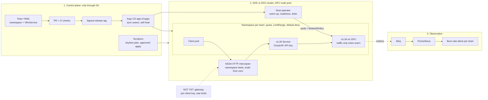

# LLM inference platform

[0 Why](#0-why-this-platform-exists) · [1 What a team can do](#1-what-a-team-can-do) · [2 Architecture](#2-architecture) · [3 Terraform, Helm, Argo CD, Kubernetes](#3-terraform-helm-argo-cd-and-kubernetes-where-and-how) · [4 Status](#4-status-by-layer) · [5 Decisions](#5-decisions) · [6 Checks](#6-how-every-claim-is-checked) · [7 Gaps](#7-known-gaps) · [8 Path](#8-path-to-production)

*Designed, built and verified under simulated production load; evidence in CI. It has not served real users.*

## 0. Why this platform exists
**Serving an LLM is mostly paying for GPUs, and the decisions that set that cost are still made by hand.**

I spent nine years building cost models for manufacturers. When I moved to LLM inference I asked the same question, what does serving cost and why, and measured it on real GPUs for five months. Three answers stood out:
- **Cold start:** a replica still loading weights is paid for and cannot serve.
- **Waiting:** agents keep GPUs busy doing nothing while their tools run.
- **Preemption:** losing a spot node only costs errors if nobody plans for it.

Each is a decision a platform should take for the team. So I built one: the team says what it needs, and the platform decides the rest.

## 1. What a team can do
**A team asks for a model in one file and gets a served endpoint, with its latency watched and its cost known, without touching GPUs, Kubernetes or alerts.**

*Example:* a support team wants a 7B model that answers within 1 second for 95% of requests, for at most 500 EUR a month. It commits [one file](https://github.com/MicheleCampi/gke-llm-inference-platform/blob/main/teams/demo/qwen-7b.yaml):

    kind: VllmService
    spec:
      model: "Qwen/Qwen2.5-7B-Instruct"
      image: "vllm/vllm-openai:v0.11.0"
      replicas: 1
      gpu: 1
      warmupStrategy: Eager
      objective: { ttftSeconds: 1.0, percentile: 95 }
      budget: { eurPerMonth: 500 }

| The team... | Today | Next |
|---|---|---|
| gets a served model from one file, validated on submit | yes | delivered by Argo CD from the model registry |
| never gets traffic on a replica that is still warming | yes (ADR-0002, 0009) | |
| keeps serving when a spot node is taken away | yes (ADR-0005, 0019) | |
| scales to zero and wakes on demand | yes, on kind (ADR-0015) | tested on GPU |
| is paged on its own error budget | yes, for a 1 s objective (ADR-0021) | any objective |
| sees its spend against its budget | budget exported; cost per run (ADR-0025) | cost per team (showback) |
| is onboarded with one command into its own namespace: GPU quota, default-deny network, boundaries checked in CI | in Git and CI ([#19](https://github.com/MicheleCampi/gke-llm-inference-platform/pull/19), [#20](https://github.com/MicheleCampi/gke-llm-inference-platform/pull/20)); not yet run live | identity per team |

**Teams are isolated in Git and checked by CI. Proving it on a live cluster, and identity per team, are step 1 of the path.**

## 2. Architecture
**Git is the only way in; the operator is the only thing that touches GPUs; every team gets its own alert.**

- **Infrastructure:** Terraform builds network, cluster and GPU pool, on GKE and on EKS.
- **Delivery:** Argo CD follows a signed release tag; a root app installs the rest in sync waves.
- **Control:** a Rust operator turns a VllmService into pods, warm-up, readiness and drain.
- **Observation:** Alloy ships the metrics; Prometheus evaluates each team's error budget.

**If it breaks.** What the design does, and where to check it.

| Failure | What happens | Evidence |
|---|---|---|
| Someone changes the cluster by hand | Argo CD puts it back as in Git (auto-sync, prune, self-heal) | `argocd/root-app.yaml`, GKE repo |
| A GPU node is drained or preempted | The replica leaves the Service 110 s before it stops; responses in flight finish; it moves to another node | ADR-0019; CI drain and preemption job, operator repo |
| A reconcile hangs | It fails after 30 s and is counted in `vcso_reconcile_failures_total` | Operator CHANGELOG |
| The model gets slow, or its metrics disappear | Burn-rate alerts on time to first token, a target-down alert, a runbook | ADR-0021; `docs/runbooks/ttft-burn-rate.md`, operator repo |
| Docker Hub is down | Builds take base images from mirror.gcr.io | Operator CHANGELOG |
| Argo CD or the operator stops | Running pods keep serving; nothing new lands until it is back | Kubernetes behaviour; not tested live here |

**Not yet:** no gateway or external endpoint, no per-client key (R2), no rate limits (D3), no identity per team, tenancy not applied live.

## 3. Terraform, Helm, Argo CD and Kubernetes: where and how
**One row per layer: the file to start reading, what it does, why, and how CI checks it.**

| | Start reading at | What it does | Why this way | Check |
|---|---|---|---|---|
| Terraform, GKE | gke [`terraform/main.tf`](https://github.com/MicheleCampi/gke-llm-inference-platform/blob/main/terraform/main.tf) -> [`modules/gke-gpu/main.tf`](https://github.com/MicheleCampi/gke-llm-inference-platform/blob/main/terraform/modules/gke-gpu/main.tf) | APIs, VPC, subnet; regional cluster, system pool, L4 pool 0..1, Workload Identity, Dataplane V2 | reviewable, reproducible; the cluster in one module | `terraform validate`, trivy (an obsolete exception fails CI), plan in CI |
| Terraform, CI identity | gke [`bootstrap/ci-identity/main.tf`](https://github.com/MicheleCampi/gke-llm-inference-platform/blob/main/bootstrap/ci-identity/main.tf) | Workload Identity pool and provider for GitHub, plan-only service account | no long-lived keys; CI plans, never applies | plan job behind an approval |
| Terraform, EKS | [eks](https://github.com/MicheleCampi/eks-llm-inference-platform), modules `vpc` and `eks` | the same platform on AWS | not tied to one cloud | `terraform validate` |
| Helm, written | operator [`chart/`](https://github.com/MicheleCampi/vllm-coldstart-operator/tree/main/chart) | operator, CRD and values as one versioned chart | one unit for Argo CD to install | `helm template` |
| Helm, consumed | gke [`argocd/apps/`](https://github.com/MicheleCampi/gke-llm-inference-platform/tree/main/argocd/apps) | argo-cd 9.5.21, external-secrets 2.6.0, alloy 1.10.0, each version pinned | an upgrade is a reviewed diff | version in Git |
| Argo CD | gke [`argocd/root-app.yaml`](https://github.com/MicheleCampi/gke-llm-inference-platform/blob/main/argocd/root-app.yaml) | root app at tag v0.5.0 installs `argocd/apps/` in sync waves: -2 root; -1 projects, argo-cd, secrets; 0 monitoring, operator; 1 alloy. One AppProject per role and per team | the cluster changes only from Git, in a stated order | sync status |
| Kubernetes, API | operator [`src/bin/crdgen.rs`](https://github.com/MicheleCampi/vllm-coldstart-operator/blob/main/src/bin/crdgen.rs) | VllmService with objective and budget; the operator owns its Deployment, Service and NetworkPolicy | the team speaks in models, not pods | gke [`ci/validate.sh`](https://github.com/MicheleCampi/gke-llm-inference-platform/blob/main/ci/validate.sh): kubeconform with CRD schemas, negative tests |
| Kubernetes, tenancy | gke [`tenants/demo/`](https://github.com/MicheleCampi/gke-llm-inference-platform/tree/main/tenants/demo), [`ci/new-team.py`](https://github.com/MicheleCampi/gke-llm-inference-platform/blob/main/ci/new-team.py) | Namespace, ResourceQuota, LimitRange and deny-all NetworkPolicy per team | onboarding is one command | [`ci/check-tenancy.py`](https://github.com/MicheleCampi/gke-llm-inference-platform/blob/main/ci/check-tenancy.py) in CI |

## 4. Status by layer
**~43%: 12 capabilities done and 6 partial, out of 35. The unknowns were done first; what remains is known engineering.**

| Layer | Items | Done | Partial |
|---|---|---|---|
| Foundations: truth and verification | 22 | 22 | 0 |
| Provisioning on two clouds | 3 | 1 | 0 |
| Delivery: GitOps and models | 3 | 0 | 1 |
| Self-service contract | 8 | 3 | 2 |
| Signals | 4 | 0 | 1 |
| Security and tenancy | 2 | 1 | 0 |
| Reliability | 8 | 5 | 1 |
| Cost | 2 | 1 | 1 |
| Operations and readiness | 5 | 1 | 0 |
| **Platform layers (excluding foundations)** | **35** | **12** | **6** |

## 5. Decisions
**Each decision: the choice, the alternative the ADR rejects, its limit, and the proof. A dash means the ADR names no alternative.**

| # | Choice | Rejected | Limit | Proof |
|---|---|---|---|---|
| D1 | Own operator in Rust (kube-rs), extended into a fleet control plane | Go; a new control plane next to it | one maintainer, own CRDs | ADR-0001, 0003 |
| D2 | Cold start is a lifecycle state; a warming replica is not capacity | cold start left implicit in pod readiness; GPU utilization as scaling signal | warmth is derived per model | ADR-0002, 0009, 0011 |
| D3 | Spot preemption: bounded reschedule; a pod leaves the Service before it stops serving | leaving it to the serving engine's SIGTERM handling | the replacement must respect the concurrency cap | ADR-0005, 0017, 0019 |
| D4 | Scale from zero through the KEDA HTTP add-on, with a bound on waiting requests | an unbounded queue at the interceptor | the first requests wait for the cold start; past the bound, 503 at once | ADR-0015 |
| D5 | Objectives per GPU class; burn-rate alerts on time to first token | - | only a 1 s objective is evaluated | ADR-0013, 0020, 0021, 0022 |
| D6 | A time limit on every reconcile | - | a stalled reconcile is retried after 30 s plus the requeue | ADR-0016 |
| D7 | Load from a trace, replayed open-loop; simulator at the speed of one L4 | - | one GPU class | ADR-0012, 0024 |
| D8 | Cost per million generated tokens per run: 4.38-8.07 EUR | - | a range tied to a load and its objectives, never one number | ADR-0025 |

ADRs: [vllm-coldstart-operator/docs/adr](https://github.com/MicheleCampi/vllm-coldstart-operator/tree/main/docs/adr)

## 6. How every claim is checked
**Every number has a command and a validity envelope.**
- `bash ci/validate.sh` in gke: kubeconform with CRD schemas, plus negative tests that must fail.
- Operator CI: `cargo fmt`, `clippy` with warnings as errors, `cargo test`, promtool rule tests with mutation.
- Releases are signed tags; Argo CD follows the tag. Merges to main need green CI.

## 7. Known gaps
**Written down before anyone finds them.**
- Only a 1 s latency objective is evaluated; others raise a ticket alert.
- No showback: the budget is exported but not compared with cost.
- Tenancy is written and checked, not yet run live; no identity per team (needs Google Groups for RBAC).
- Terraform apply is manual, from an approved plan.
- Single region; no edge or DDoS layer. These are design answers, not code.

## 8. Path to production
**In order; each step closes a row of section 4.**
1. Tenancy live: verify isolation on the cluster, add identity per team, then onboarding as an ApplicationSet over a team chart, so a team is one values file.
2. Showback: projected cost per team against its budget, alert before overrun.
3. Any latency objective, not only 1 s.
4. Apply from CI with approval; model delivery by Argo CD.
5. Scale to zero tested on GPU; load test at target traffic.
6. Upgrade and DR runbooks; production readiness review per component.
7. Multi-region and edge: design first, then build.
