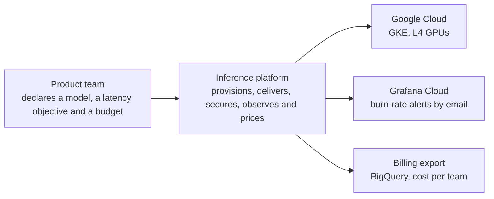
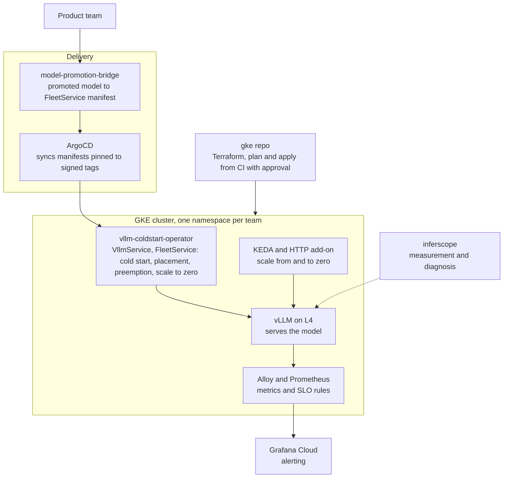

# Architecture

C4 views of the platform: who uses it (context) and what runs inside it
(containers). Validity: designed, built and verified under simulated
production load on GKE, one region (us-central1), not operated in
production. The AWS side is a separate project and is not drawn here.

## Context

## Containers

## Where each piece lives

- Operator: [vllm-coldstart-operator](https://github.com/MicheleCampi/vllm-coldstart-operator)
- Cluster and GitOps: [gke-llm-inference-platform](https://github.com/MicheleCampi/gke-llm-inference-platform)
- Readiness against a checklist: [prr.md](prr.md); numbers: [r6-report.md](r6-report.md)
