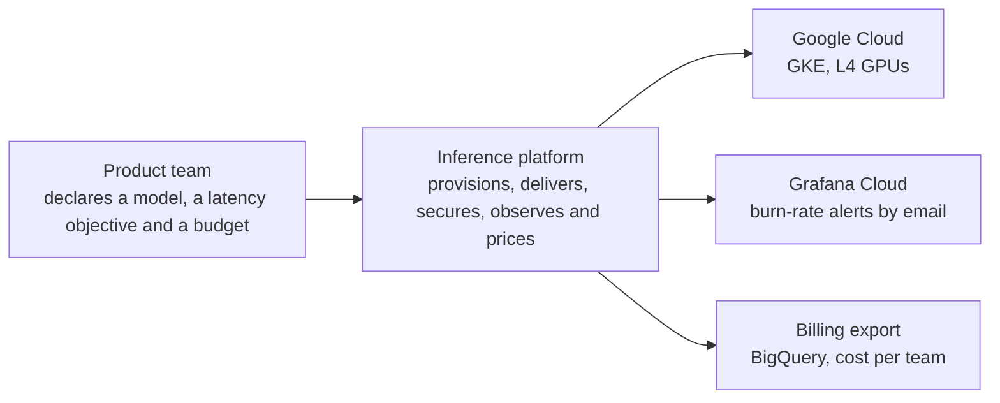
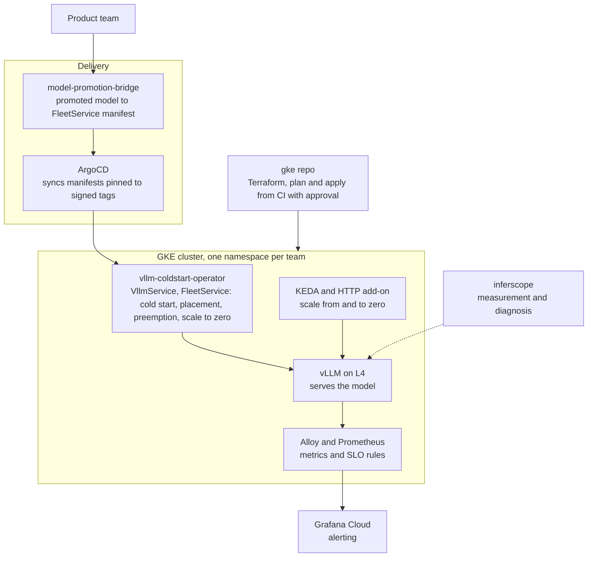

# Architecture

C4 views of the platform: who uses it (context) and what runs inside it
(containers). Validity: designed, built and verified under simulated
production load on GKE, one region (us-central1), not operated in
production. The AWS side is a separate project and is not drawn here.

## Context

## Containers

## Where each piece lives

- Operator: [vllm-coldstart-operator](https://github.com/MicheleCampi/vllm-coldstart-operator)
- Cluster and GitOps: [gke-llm-inference-platform](https://github.com/MicheleCampi/gke-llm-inference-platform)
- Readiness against a checklist: [prr.md](prr.md); numbers: [r6-report.md](r6-report.md)

## Contracts between repos

- model-promotion-bridge writes a FleetService manifest; the operator's CRD is the contract it must validate against.
- The gke repo pins the operator by tag and commit; ArgoCD syncs only manifests pinned to signed tags.
- The operator publishes the SLO rules (deploy/monitoring/slo-rules.yaml), tested by promtool in CI; Grafana Cloud runs a copy.

## Failure domains

- One region (us-central1); a regional outage stops serving. Recovery is a rebuild from Git, drilled once ([upgrade and DR](https://github.com/MicheleCampi/gke-llm-inference-platform/blob/main/docs/upgrade-and-dr.md#drill-9-november-2026)).
- The system pool runs in one zone.
- L4 capacity is on demand with no reservation; stockouts are recorded in [PM-001](postmortems/pm-001-l4-stockouts.md).
- Alert routing lives in Grafana Cloud, outside any repository.
